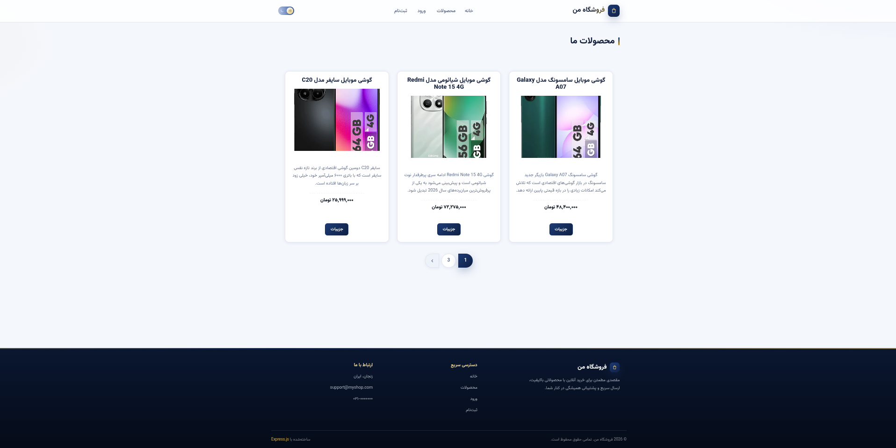
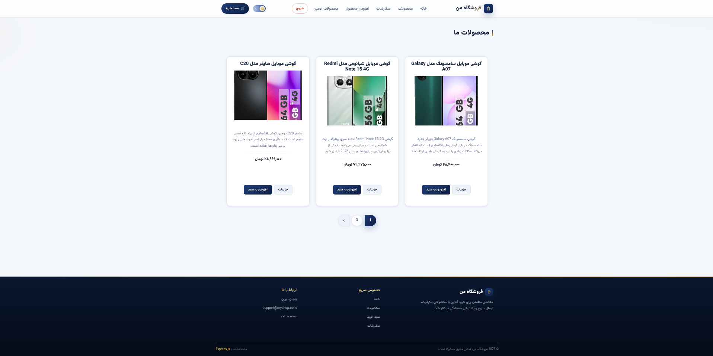
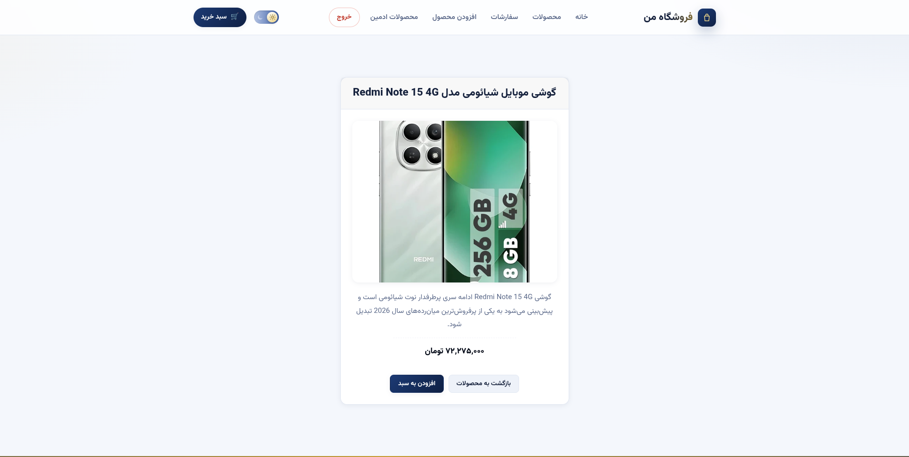
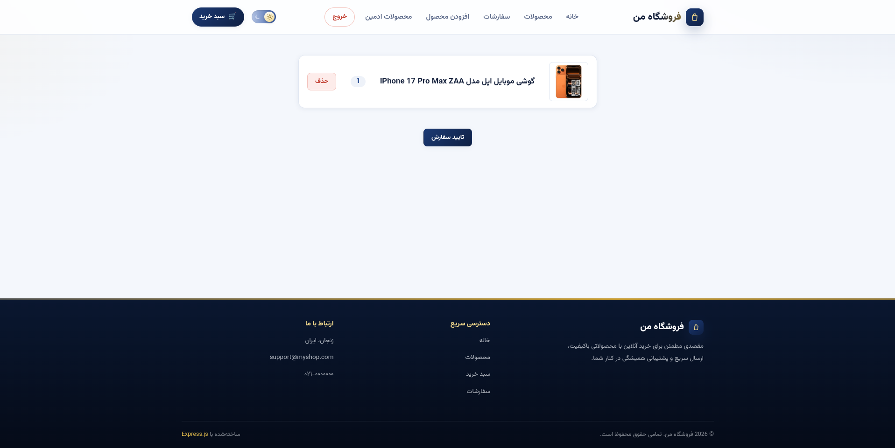
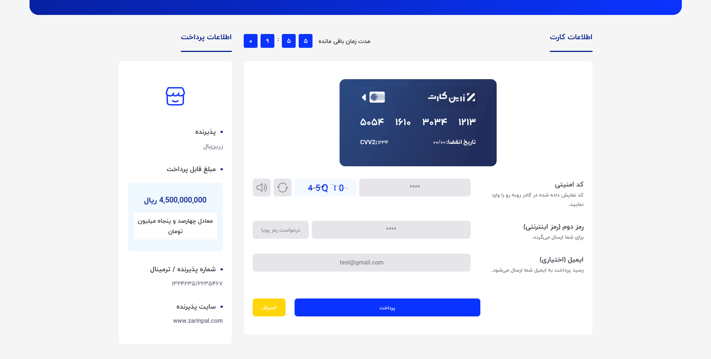
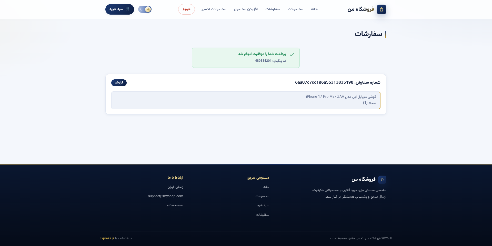
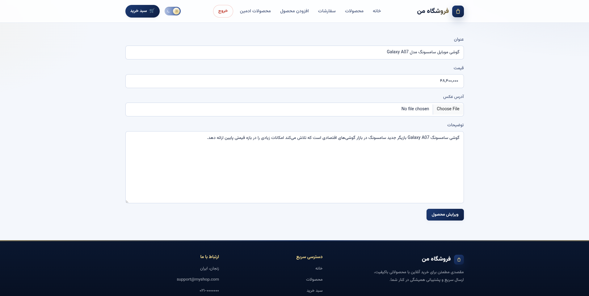
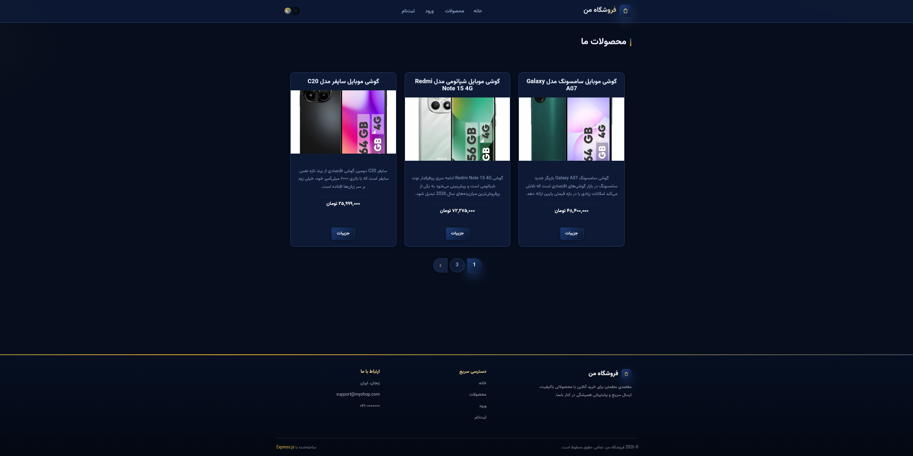

# My Shop

My Shop is a full-stack e-commerce web application built with **Node.js**, **Express**, **MongoDB**, and **EJS**. This project focuses on core backend concepts such as routing, MVC architecture, database integration, authentication, session management, and server-side rendering.

The application provides a complete shopping experience including user authentication, product management, shopping cart, checkout, order management, password recovery, online payment, and PDF invoice generation.

---

## Project Screenshots

### Home Page



### Products List



### Product Details



### Checkout Page



### Payment



### Orders



### Product Management



### Dark Theme



---

## Features

* User registration and login
* Session-based authentication
* Password hashing with bcryptjs
* Password recovery through email
* CSRF protection
* Server-side input validation
* Display all products
* View product details
* Add products to shopping cart
* Remove products from shopping cart
* Product pagination
* Create new products
* Edit existing products
* Delete products
* Product image upload
* Checkout system
* Order creation and order history
* Online payment with ZarinPal
* PDF invoice generation
* Flash messages
* Custom 500 error page
* Light and dark theme

---

## Project Structure

The application follows the **MVC (Model–View–Controller)** pattern to keep the code organized and maintainable.

* **Models**: Define the data structure using Mongoose
* **Views**: EJS templates rendered on the server
* **Controllers**: Handle application logic and communicate between models and views
* **Routes**: Define application endpoints and map them to controllers
* **Middleware**: Handle authentication and request processing
* **Utils**: Provide reusable utility functions

---

## Technologies Used

* Node.js
* Express.js
* MongoDB
* Mongoose
* EJS (Embedded JavaScript Templates)
* HTML
* CSS
* JavaScript
* bcryptjs
* express-validator
* express-session
* connect-mongodb-session
* connect-flash
* Multer
* Nodemailer
* PDFKit
* ZarinPal Checkout

---

## Server-Side Rendering with EJS

The project uses **EJS** as the view engine to render dynamic HTML pages on the server.

How it works:

* Requests are handled by Express routes
* Controllers process application logic
* Controllers communicate with MongoDB using Mongoose
* Data is passed to EJS templates
* EJS generates the final HTML pages sent to the browser

This approach is known as **server-side rendering**.

More information: [EJS](https://ejs.co)

---

## Authentication

The project implements a session-based authentication system.

Users can:

* Create a new account
* Log in and log out
* Access protected pages
* Reset their password through email

Passwords are securely hashed using **bcryptjs** before being stored in the database.

The application also uses **CSRF protection** and **express-validator** for request validation.

---

## Database

**MongoDB** is used as the database, with **Mongoose** as the ODM.

The application contains three main models:

### User

The user schema includes:

* email
* password
* cart
* resetToken
* expiredResetDateToken

### Product

The product schema includes:

* title
* price
* description
* image
* userID

### Order

The order schema includes:

* products
* quantity
* user information
* userID

---

## Shopping Cart

Users can add products to their shopping cart and manage the quantity of each product.

The cart is stored as part of the user's data in MongoDB.

The shopping process includes:

* Adding products to the cart
* Increasing product quantity
* Removing products
* Viewing the cart
* Proceeding to checkout

---

## Payment

The project includes **ZarinPal** payment integration.

The payment process includes:

* Creating a payment request
* Redirecting the user to the payment gateway
* Receiving the payment callback
* Checking the payment status
* Creating the order after successful payment

---

## PDF Invoice

After creating an order, users can generate a PDF invoice using **PDFKit**.

The invoice contains information about the purchased products and their quantities.

---

## Routes Overview

### Shop Routes

* `/` – Home page
* `/products` – Show all products
* `/products/:productID` – View product details
* `/cart` – View shopping cart
* `/cart-delete-item` – Remove a product from cart
* `/checkout` – Checkout page
* `/create-order` – Create a new order
* `/orders` – View user orders
* `/invoices/:orderID` – Generate PDF invoice
* `/paymentRequest` – Create payment request
* `/checkPayment` – Check payment status

### Authentication Routes

* `/login` – Login page
* `/sign-up` – Registration page
* `/logout` – Logout
* `/reset` – Password recovery
* `/reset/:token` – Password reset page
* `/new-password` – Set a new password

### Admin Routes

* `/admin/add-product` – Add a new product
* `/admin/products` – Manage products
* `/admin/edit-product/:productID` – Edit a product
* `/admin/edit-product` – Update a product
* `/admin/product/:productID` – Delete a product

---

## Setup and Installation

### Prerequisites

* Node.js
* MongoDB (local or cloud instance)

### Installation Steps

1. Clone the repository:

```bash
git clone https://github.com/amirhoseinpourmand/my-shop.git
